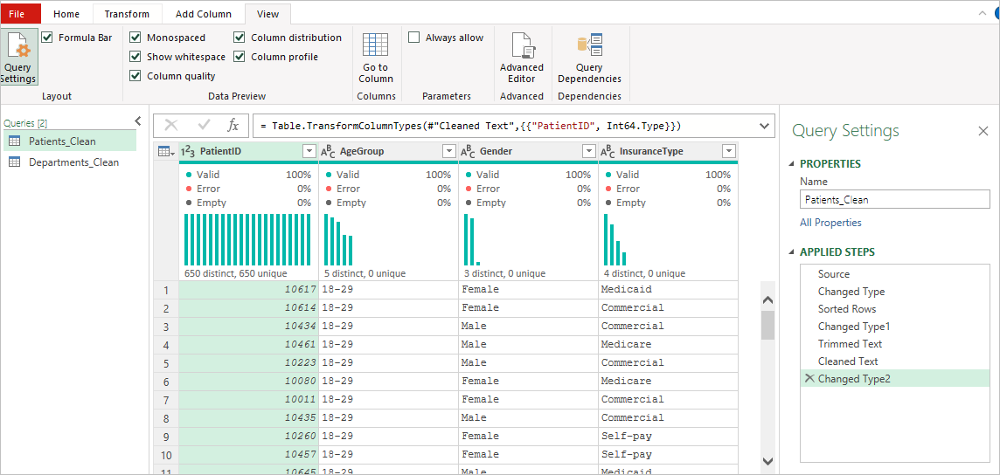
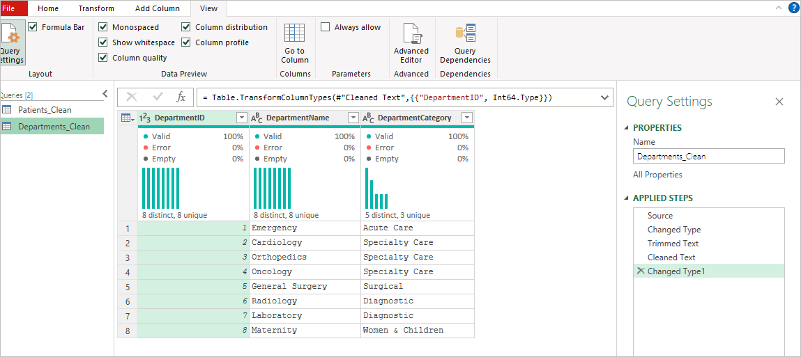

## Power Query Data Cleaning Evidence

### Patients Dataset

### Departments Dataset

# Healthcare Data Cleaning & Quality Assessment

**Microsoft Excel | Power Query | Healthcare Analytics | Data Quality**

## 1. Project Overview

This project demonstrates a structured approach to cleaning, profiling, validating, and preparing healthcare datasets using Microsoft Excel Power Query.

The project forms part of a broader Healthcare Revenue Cycle Analytics portfolio focused on improving data reliability for healthcare reporting, operational analysis, and revenue cycle performance monitoring.

**Project:** Healthcare Data Cleaning — Task 1  
**Tool:** Microsoft Excel Power Query  
**Datasets:** Patients and Departments  
**Status:** Data cleaning and initial validation completed

## 2. Business Problem

Healthcare organisations rely on accurate and consistent data for patient administration, departmental reporting, financial analysis, and operational decision-making.

Poor data quality can lead to:

- Inaccurate reporting and analysis
- Duplicate patient or department records
- Inconsistent classifications
- Data integration errors
- Unreliable performance indicators

This project addresses these risks through systematic data profiling and standardisation.

## 3. Project Objectives

1. Assess completeness and uniqueness of dataset records.
2. Identify missing values, duplicate identifiers, and transformation errors.
3. Standardise data types and categorical fields.
4. Apply reproducible Power Query transformations.
5. Document cleaning activities and validation results.
6. Prepare the datasets for subsequent healthcare analytics.

## 4. Dataset Overview

| Dataset | Records | Columns   | Primary Identifier |
|---|---:|---:|---|
| Patients     | 650     | 4         | PatientID |
| Departments   | 8       | 3       | DepartmentID |
| **Total** | **658**   | **7** | |

### Patients Dataset

| Column | Description | Data Type |
|---|---|---|
| PatientID | Unique patient identifier | Whole Number |
| AgeGroup | Patient age classification | Text |
| Gender | Patient gender category | Text |
| InsuranceType | Patient insurance classification | Text |

### Departments Dataset

| Column | Description | Data Type |
|---|---|---|
| DepartmentID | Unique department identifier | Whole Number |
| DepartmentName | Healthcare department name | Text |
| DepartmentCategory | Department classification | Text |

## 5. Tools and Techniques

**Primary tool:** Microsoft Excel Power Query

Techniques demonstrated:

- Data import and transformation
- Column Quality profiling
- Column Distribution analysis
- Column Profile inspection
- Missing-value detection
- Duplicate identifier validation
- Data-type correction
- Text.Trim and Text.Clean transformations
- Categorical consistency assessment
- Data-quality documentation

## 6. Data Cleaning Methodology

### Step 1 — Data Import

The Patients and Departments datasets were imported into Excel Power Query.

The original data was retained separately to support traceability and reproducibility.

### Step 2 — Data Profiling

Power Query's Column Quality, Column Distribution, and Column Profile features were used to examine completeness, distinct values, uniqueness, and errors.

### Step 3 — Data-Type Validation

Identifier columns were assigned Whole Number data types, while categorical fields were maintained as Text.

### Step 4 — Text Standardisation

Trim and Clean transformations were applied to standardise text formatting and remove unnecessary whitespace and non-printable characters.

### Step 5 — Categorical Validation

Age groups, gender classifications, insurance types, department names, and department categories were reviewed for consistency.

### Step 6 — Final Validation

The transformed datasets were assessed for missing values, duplicate identifiers, and Power Query errors.

## 7. Data Quality Assessment Results

| Quality Metric | Patients | Departments |
|---|---:|---:|
| Total records | 650 | 8 |
| Unique primary IDs | 650 | 8 |
| Duplicate primary IDs | 0 | 0 |
| Missing values | 0 | 0 |
| Power Query errors | 0 | 0 |
| Data types validated | Yes | Yes |
| Text standardisation | Completed | Completed |
| Categorical review | Completed | Completed |

### Key Findings

**Patients Dataset**

- All 650 PatientIDs were unique.
- No missing values or Power Query errors were detected.
- Five age-group categories were identified.
- Three gender categories were identified.
- Four insurance categories were identified.
- PatientID was converted to Whole Number.

**Departments Dataset**

- All eight DepartmentIDs were unique.
- Eight distinct department names were identified.
- Five department categories were identified.
- No missing values or Power Query errors were detected.
- DepartmentID was validated as Whole Number.

These results describe the documented quality checks. They do not independently establish the accuracy of every source value or relationships with other healthcare datasets.

## 8. Power Query Cleaning Evidence

The following screenshots document the data-profiling results and Power Query transformation steps.

### Patients Dataset

Screenshot evidence includes:

- Column Quality results
- Column Distribution
- Unique patient identifiers
- Data-type correction
- Applied Steps

**Screenshot:** Add the verified Patients screenshot path here.

### Departments Dataset

Screenshot evidence includes:

- Department identifier validation
- Column Quality and Distribution
- Department category profiling
- Trim and Clean transformations
- Applied Steps

**Screenshot:** Add the verified Departments screenshot path here.

## 9. Business Insights

The initial quality assessment found complete fields and unique primary identifiers in both datasets.

Standardised data types and categorical values provide a more consistent foundation for subsequent analysis.

The datasets can now be considered for integration with other healthcare tables, subject to further relationship and referential-integrity checks.

## 10. Project Deliverables

- Excel data-cleaning workbook
- Patients data-quality assessment
- Departments data-quality assessment
- Documented Power Query transformations
- Data-cleaning log
- Data-quality summary
- Power Query screenshots

## 11. Next Steps

The next phase of the broader Healthcare Revenue Cycle Analytics project will focus on:

1. Cleaning billing, insurance claims, and payment datasets.
2. Validating relationships between healthcare tables.
3. Assessing revenue and payment collection performance.
4. Developing healthcare financial KPIs.
5. Creating an interactive Power BI dashboard.

## 12. Skills Demonstrated

**Technical:** Excel, Power Query, data profiling, transformation, validation, and data preparation.

**Analytical:** Data-quality assessment, categorical analysis, error identification, and documentation.

**Professional:** Reproducible workflows, structured reporting, and business-focused communication.

---

**Author:** Adesola A. Sulaiman  
**Project:** Healthcare Revenue Cycle Analytics Portfolio  
**Repository:** https://github.com/AdesolaASulaiman/Healthcare-Data-Cleaning-task1

